# Smart Attendance — Điểm danh bằng nhận diện khuôn mặt

Web app điểm danh sinh viên chạy cục bộ trên Windows: mở trình duyệt tại **http://127.0.0.1:8000**, bật webcam (hoặc camera IP RTSP), hệ thống phát hiện khuôn mặt bằng **SCRFD**, nhận diện bằng **AdaFace IR101** và ghi điểm danh vào **SQLite**, xuất báo cáo **Excel**.

Đồ án môn Thị giác máy tính (CPV301), FPT University Hà Nội, Nhóm 5. **Vai trò của tôi:** trưởng nhóm, xây dựng pipeline phát hiện và nhận diện khuôn mặt; sau đó nâng cấp thành web app (FastAPI + React) và chuyển mô hình nhận diện từ ArcFace sang AdaFace.

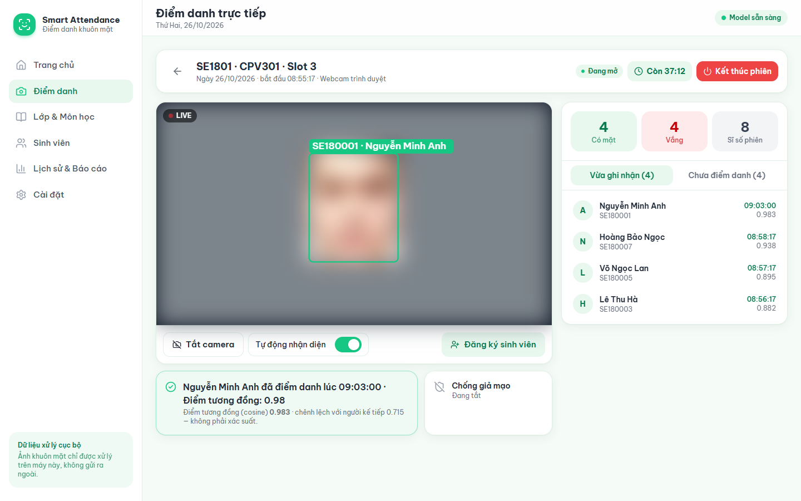

> Mọi ảnh trong README được chụp từ một bản demo với **tên giả** và **khuôn mặt đã làm mờ**.

## Tính năng

- **Lớp & môn học**: tạo/sửa/xoá lớp và cặp lớp–môn; xoá cấu hình không làm mất lịch sử.
- **Sinh viên**: đăng ký khuôn mặt bằng webcam (tối đa 5 mẫu, mỗi mẫu được kiểm tra ngay) hoặc **import hàng loạt từ file Excel có ảnh**; tìm kiếm, sửa, xoá, xem lịch sử, cập nhật mẫu khuôn mặt.
- **Phiên điểm danh**: chọn lớp, môn, slot 1–20, thời lượng hoặc không giới hạn; phiên xác định theo *lớp + môn + ngày + slot*, mở lại sẽ tải dữ liệu cũ; hạn giờ do backend quản lý nên tải lại trang không đặt lại bộ đếm.
- **Điểm danh trực tiếp**: webcam của trình duyệt (qua WebSocket) hoặc camera IP RTSP; khung nhận diện có nhãn chữ + màu (đã nhận diện, người lạ, nhiều khuôn mặt, không thể xác minh, giả mạo); bảng có mặt/vắng cập nhật tức thì.
- **Lịch sử & báo cáo**: lọc theo ngày, lớp, môn, slot, sinh viên, trạng thái; xuất Excel đúng bộ lọc từ SQLite. Số vắng được tính theo **danh sách sinh viên của từng phiên**, không lấy tổng sinh viên trừ số có mặt.
- **Cài đặt**: ngưỡng cosine, margin, ngưỡng phát hiện, tốc độ gửi khung hình, tiền xử lý, chống giả mạo, RTSP, tình trạng model, chuyển đổi/rollback embedding.
- Giao diện xanh lá–trắng, tiếng Việt, dùng được trên **desktop và điện thoại**.

## Ảnh giao diện

| Trang chủ | Lớp & Môn học |
|---|---|
| 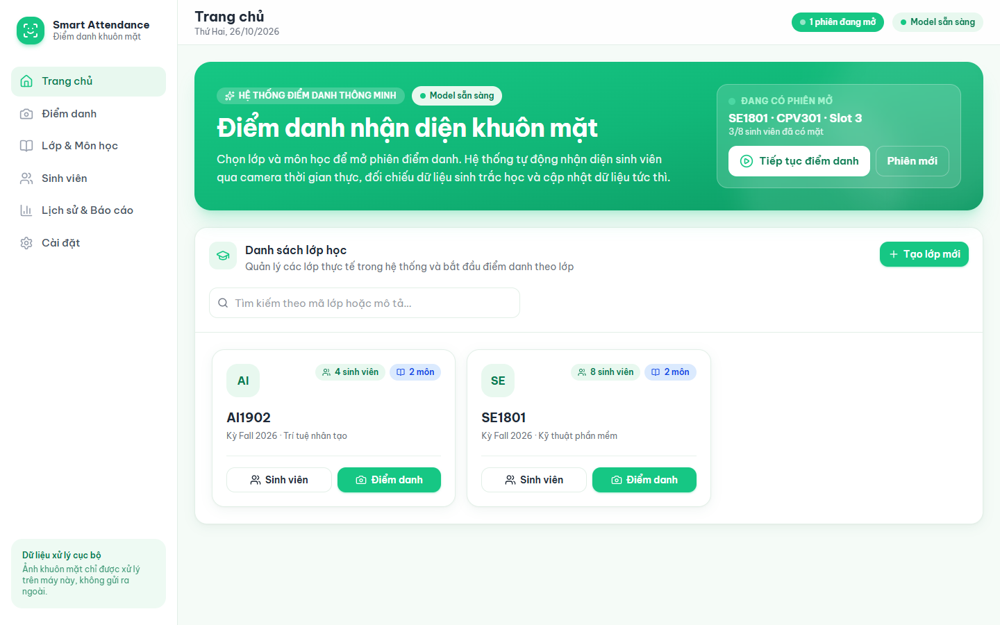 | 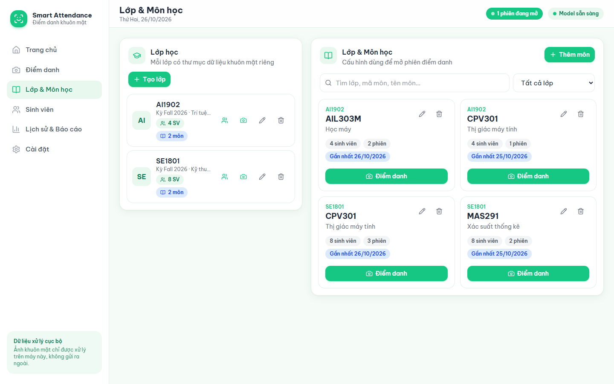 |
| **Thiết lập phiên** | **Đăng ký khuôn mặt** |
| 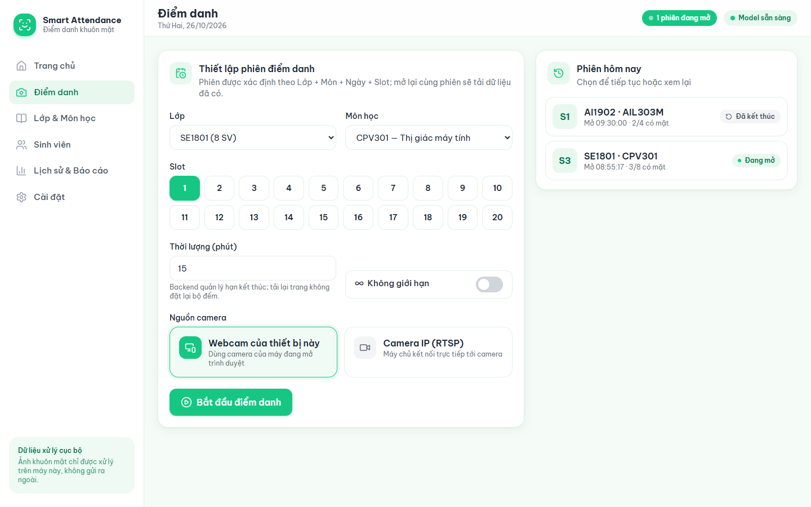 | 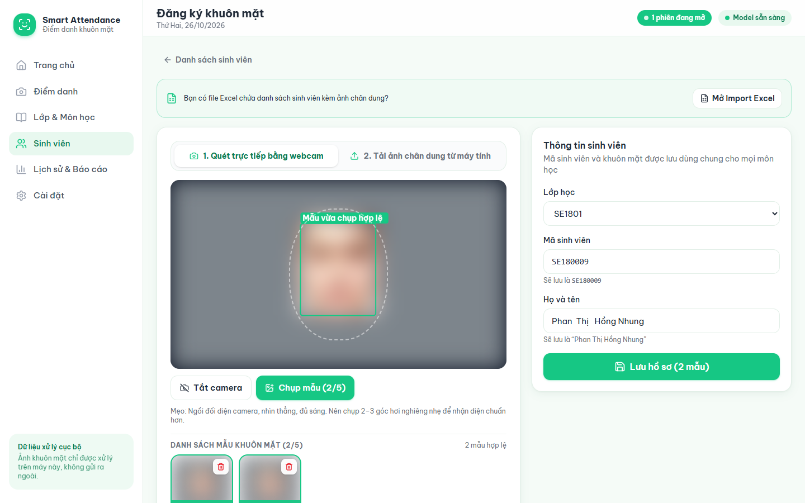 |
| **Sinh viên** | **Lịch sử & Báo cáo** |
| 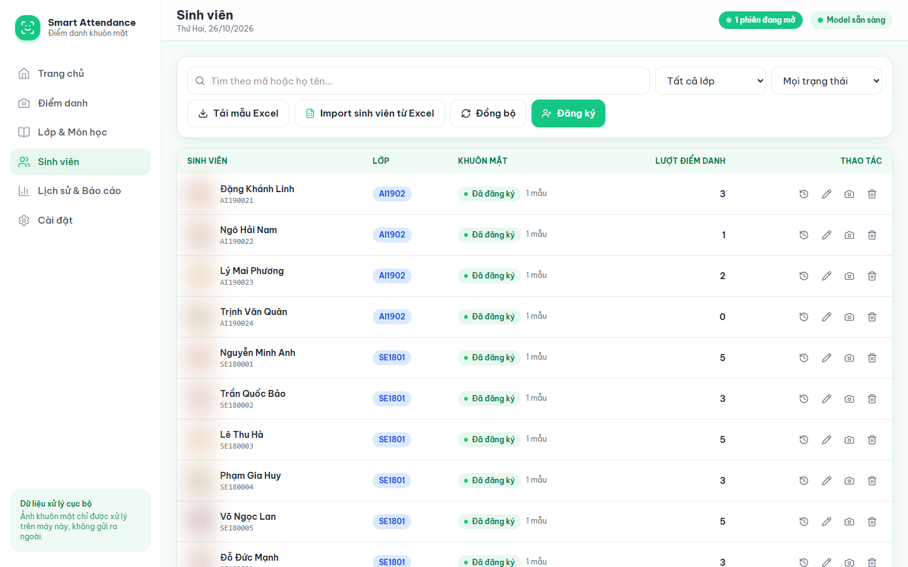 | 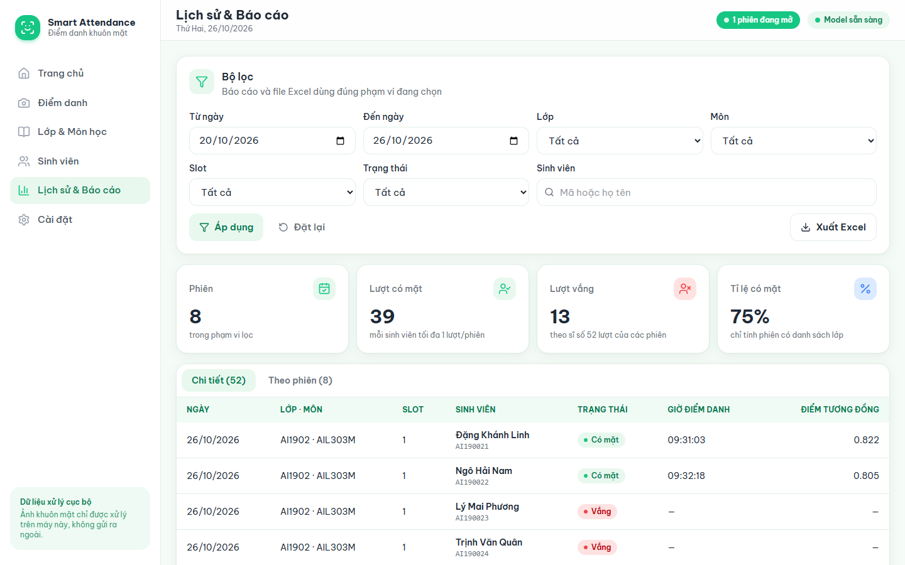 |
| **Cài đặt** | **Điện thoại** |
| 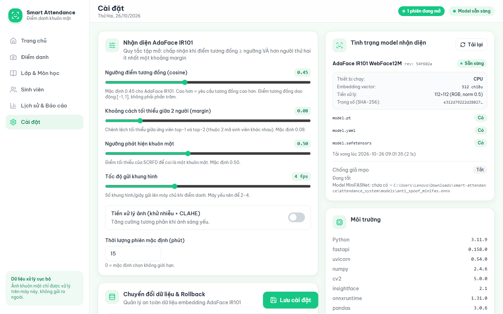 |

## Mô hình cũ và mô hình mới

| | Cũ | Mới |
|---|---|---|
| Phát hiện | SCRFD `det_500m` (InsightFace buffalo_sc) | SCRFD `det_500m` (chỉ chạy phần phát hiện) |
| Nhận diện | ArcFace MobileFaceNet `w600k_mbf` (buffalo_sc) | **AdaFace IR101 WebFace12M** (CVPR 2022), căn chỉnh 112×112 theo 5 điểm mốc |
| Ngưỡng cosine / margin | 0.60 / 0.08 | 0.45 / 0.08 |
| Thời gian trích xuất mỗi khuôn mặt (CPU) | 5–7 ms | 640–860 ms |

Các biểu đồ dưới đây được đo trên máy phát triển (Intel i5-13420H, không GPU) với **8 người, mỗi người 1 ảnh đăng ký**. Ảnh "biến đổi" được tạo nhân tạo từ chính ảnh đăng ký (dịch vị trí, thu nhỏ, làm mờ, tối/sáng, nhiễu, nén JPEG, xoay). Đây là phép so sánh **minh hoạ trên tập rất nhỏ**, không phải benchmark độ chính xác; muốn kết luận cần bộ dữ liệu đánh giá riêng theo [docs/EVALUATION.md](docs/EVALUATION.md).

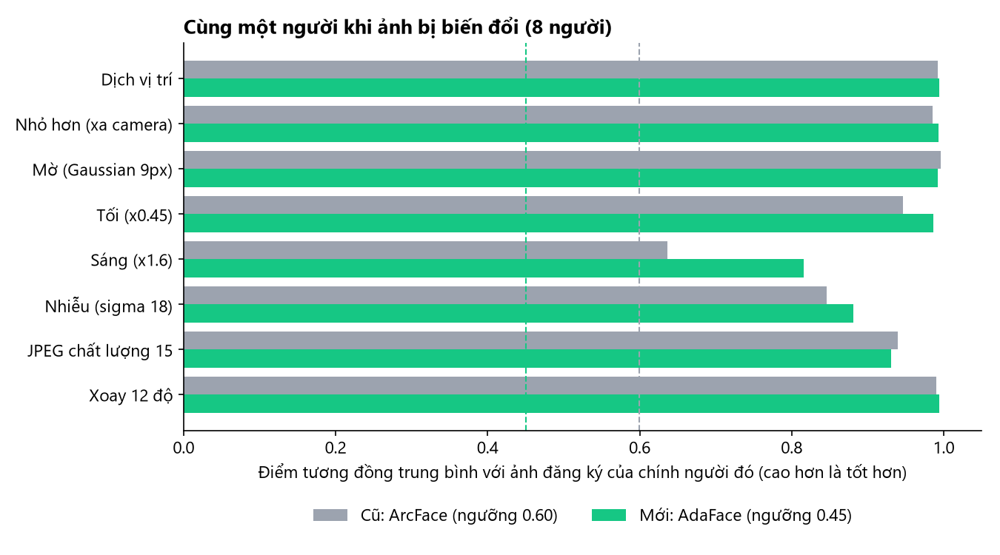

| Biến đổi | Điểm TB — ArcFace cũ | Điểm TB — AdaFace mới | Nhận đúng — cũ | Nhận đúng — mới |
|---|---|---|---|---|
| Dịch vị trí | 0.992 | 0.995 | 8/8 | 8/8 |
| Nhỏ hơn (xa camera) | 0.986 | 0.993 | 8/8 | 8/8 |
| Mờ (Gaussian 9px) | 0.996 | 0.992 | 8/8 | 8/8 |
| Tối (×0.45) | 0.947 | **0.986** | 8/8 | 8/8 |
| Sáng (×1.6) | 0.637 | **0.816** | 7/8 | **8/8** |
| Nhiễu (σ = 18) | 0.846 | 0.881 | 8/8 | 8/8 |
| JPEG chất lượng 15 | 0.940 | 0.931 | 8/8 | 8/8 |
| Xoay 12° | 0.991 | 0.995 | 8/8 | 8/8 |

AdaFace giữ điểm tương đồng ổn định hơn rõ nhất khi ảnh **quá sáng** (0.64 → 0.82) và **tối** (0.95 → 0.99); với ảnh sáng, ArcFace bỏ sót 1/8 người vì điểm rơi sát ngưỡng 0.60. Ở các biến đổi khác hai mô hình tương đương.

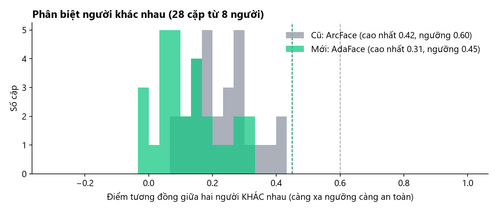

Với 28 cặp người khác nhau, AdaFace cho điểm thấp hơn (trung bình 0.13, cao nhất 0.31) so với ArcFace (trung bình 0.23, cao nhất 0.42). Khoảng cách từ cặp giống nhau nhất tới ngưỡng là 0.14 (AdaFace, ngưỡng 0.45) và 0.18 (ArcFace, ngưỡng 0.60); cả hai đều không nhận nhầm cặp nào.

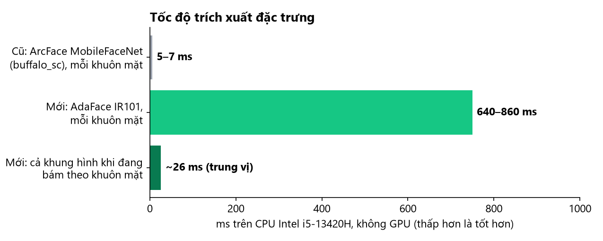

AdaFace IR101 nặng hơn ~100 lần trên CPU. Để giữ trải nghiệm mượt, backend **bám theo khuôn mặt**: khi cùng một khuôn mặt vẫn ở cùng chỗ (IoU ≥ 0.45 và ảnh thu nhỏ 32×32 gần giống khung trước), hệ thống dùng lại kết quả AdaFace gần nhất và chỉ xác minh lại mỗi 2.5 giây (người lạ: 1 giây). Kết quả dùng lại **không bao giờ ghi điểm danh**. Nhờ vậy mỗi khung hình chỉ tốn ~26 ms (trung vị); chỉ khung có người mới mất ~0.7 s. Ngoài ra bộ phát hiện tắt cơ chế *spinning* của ONNX Runtime để không tranh CPU với PyTorch (detect + AdaFace: ~1.4 s → ~0.8 s).

**Pipeline mỗi khung hình:** kiểm tra ảnh (≤ 3 MB) → tiền xử lý (tuỳ chọn) → phát hiện khuôn mặt → chọn mặt chính (mặt nhỏ ở xa bị bỏ qua, mặt thứ hai đáng kể → *Nhiều khuôn mặt*) → bám khuôn mặt (nếu trúng thì trả kết quả cũ) → chống giả mạo (nếu bật) → embedding AdaFace → so khớp với danh sách lớp của phiên: chấp nhận khi **cosine ≥ ngưỡng và hơn người thứ hai ≥ margin** → kiểm tra phiên còn mở **trong cùng transaction** → ghi SQLite → trả kết quả.

**Dữ liệu:** SQLite là nguồn chính. Bảng `attendance` cũ được giữ nguyên (chỉ thêm cột) nên app desktop PyQt5 vẫn dùng chung dữ liệu; thêm các bảng `classes`, `courses`, `students`, `sessions`, `session_roster`, `settings`. Chỉ mục duy nhất `(lớp, môn, mã SV, ngày, slot)` chặn điểm danh trùng kể cả khi nhiều request đến cùng lúc. Migration tự sao lưu `attendance.db` vào `attendance_system/backups/` trước khi đổi schema.

## Cài đặt và chạy (Windows)

Yêu cầu: Windows 10/11, **Python 3.11** (đã kiểm thử 3.11.9). Node.js không bắt buộc — nếu máy chưa có, setup tải bản portable vào `tools\node` (có kiểm tra checksum).

1. Cài đặt (một lần):

   ```bash
   Cai-Dat.cmd
   ```

   Tạo/dùng `attendance_system\.venv`, cài thư viện Python, kiểm tra model, cài và build giao diện. Không xoá môi trường hay dữ liệu sẵn có.

2. Đặt model vào `attendance_system\models\` (không có trong repo vì dung lượng lớn):
   - `insightface\models\buffalo_sc\det_500m.onnx` — tự tải khi chạy lần đầu nếu có mạng.
   - `cvlface_adaface_ir101_webface12m\` — checkpoint [minchul/cvlface_adaface_ir101_webface12m](https://huggingface.co/minchul/cvlface_adaface_ir101_webface12m) (`pretrained_model/model.pt`, `model.yaml` và mã kiến trúc).

3. Chạy:

   ```bash
   Chay-SmartAttendance.cmd
   ```

   Trình duyệt tự mở **http://127.0.0.1:8000**. Giữ cửa sổ đen mở trong lúc dùng; đóng nó để dừng server. Phải mở bằng `127.0.0.1`/`localhost` — trình duyệt chặn camera trên địa chỉ IP LAN không có HTTPS.

## Cách dùng

1. **Lớp & Môn học** → tạo lớp (VD `SE1801`) → thêm môn (VD `CPV301`).
2. **Sinh viên** → *Đăng ký*: chọn lớp, nhập mã và họ tên, bật camera, chụp 3–5 mẫu → *Lưu hồ sơ*. Hoặc tải mẫu Excel, điền danh sách kèm ảnh chân dung và *Import*.
3. **Điểm danh** → chọn lớp, môn, slot, thời lượng, nguồn camera → *Bắt đầu điểm danh* → *Bật camera*, giữ *Tự động nhận diện* bật; từng sinh viên đứng trước camera.
4. *Kết thúc phiên* (hoặc để hết giờ): backend từ chối mọi kết quả đến muộn.
5. **Lịch sử & Báo cáo** → lọc → *Xuất Excel*.

Mã sinh viên được chuẩn hoá một lần ở backend (viết hoa, giữ số 0 ở đầu), họ tên tiếng Việt được chuẩn hoá Unicode và bỏ khoảng trắng thừa.

## Cấu trúc thư mục

```
backend/                 FastAPI: app.py, schemas, db/migration, services/
frontend/                React + TypeScript + Vite + Tailwind
attendance_system/       module nhận diện dùng chung + app desktop PyQt5 cũ (main.py)
  functions/             face_detector, adaface_service, face_recognizer, matching, identity, anti_spoof…
  evaluate.py            đánh giá offline + quét ngưỡng (dùng AdaFace như app)
tests/                   pytest cho backend (model giả + 1 test model thật)
docs/                    EVALUATION.md, images/
setup.ps1, run.ps1, Cai-Dat.cmd, Chay-SmartAttendance.cmd
```

## API chính

| Nhóm | Endpoint |
|---|---|
| Hệ thống | `GET /api/health`, `GET /api/system`, `GET /api/models/status`, `GET /api/models/info`, `POST /api/models/reload` |
| Lớp / môn | `GET·POST /api/classes`, `PATCH·DELETE /api/classes/{id}`, `GET·POST /api/courses`, `PATCH·DELETE /api/courses/{id}` |
| Sinh viên | `GET·POST /api/students`, `GET·PATCH·DELETE /api/students/{id}`, `/history`, `/face`, `/photos/{tên}`, `POST /api/enrollment/check`, `POST /api/students/sync` |
| Import Excel | `GET /api/students/import/template`, `POST /api/students/import/preview`, `POST /api/students/import/commit` |
| Phiên | `GET·POST /api/sessions`, `GET /api/sessions/{id}`, `/records`, `POST /end`, `POST /reopen` |
| Nhận diện | `WS /ws/sessions/{id}` (4 byte frame_id + 1 byte cờ ghi + JPEG), `POST /api/sessions/{id}/frame` |
| RTSP | `POST /api/sessions/{id}/rtsp/start`, `/stop`, `PATCH /rtsp`, `GET /rtsp/status`, `GET /rtsp/stream` (MJPEG) |
| Báo cáo | `GET /api/history`, `GET /api/reports/export` |
| Model | `GET /api/models/migration/status`, `POST /api/models/migrate`, `POST /api/models/rollback`, `GET /api/models/calibration` |
| Cài đặt | `GET·PUT /api/settings` |

Tài liệu tương tác: http://127.0.0.1:8000/docs

## Kiểm thử

```bash
attendance_system\.venv\Scripts\python -m pytest tests
```

Kết quả gần nhất (Windows 11, Python 3.11.9): **48 passed, 4 skipped**; test cũ trong `attendance_system/tests`: **10 passed**.

- Phần lớn test dùng **model giả** nhưng chạy code thật của detector, recognizer, quy tắc so khớp, anti-spoof, SQLite và API: hai lớp cùng môn/slot/ngày, mở lại phiên, 12 request ghi đồng thời, ID chữ thường/số 0 ở đầu, tên tiếng Việt, người lạ, nhiều khuôn mặt, anti-spoof lỗi, kết quả đến sau khi phiên kết thúc, phiên qua nửa đêm, xuất Excel khớp SQLite, migration DB cũ, bám khuôn mặt… Model giả gắn kèm một vector "ArcFace mồi" cho mỗi khuôn mặt để đảm bảo code chỉ dùng AdaFace.
- `tests/test_real_model.py` dùng **AdaFace và SCRFD thật** (đăng ký rồi nhận diện qua đúng pipeline).
- 4 test tích hợp gọi vào server đang chạy và **sửa dữ liệu thật**, nên chỉ chạy khi đặt `SA_LIVE_SERVER_TESTS=1`.

## Quyền riêng tư

Ảnh khuôn mặt và embedding là dữ liệu sinh trắc học. Mọi xử lý chạy trên máy, không gửi ra ngoài. Repo **không chứa** khuôn mặt, embedding, database hay file điểm danh (`dataset/`, `attendance.db`, `backups/`, `exports/`, model đều nằm trong `.gitignore`). Chỉ đăng ký những người đã đồng ý.

## Hạn chế và hướng phát triển

- So sánh mô hình ở trên dùng 8 người, 1 ảnh mỗi người và biến đổi nhân tạo; cần bộ dữ liệu đánh giá thật (nhiều buổi, ánh sáng, góc mặt, người lạ) để chọn ngưỡng có căn cứ.
- AdaFace trên CPU mất ~0.7 s cho mỗi người mới; có thể tăng tốc bằng xuất ONNX, lượng tử hoá hoặc GPU.
- Chống giả mạo đang **tắt**: chưa có model MiniFASNet; chế độ texture chỉ là thử nghiệm.
- Ứng dụng chỉ nghe trên `127.0.0.1` và chưa có đăng nhập; không nên mở ra mạng LAN khi chưa thêm xác thực.
- Webcam và RTSP thật cần được kiểm thử trên từng máy (xem các trạng thái lỗi camera trong trang điểm danh).
